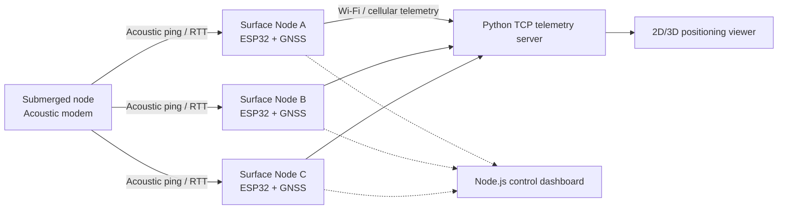

# Underwater Acoustic Telemetry and Positioning System

**ESP32-S3 firmware, underwater acoustic ranging, GNSS/LTE-M telemetry and web-based monitoring** for an experimental network of surface and submerged nodes.

**Context:** Summer 2026 internship at Universitat Politècnica de Catalunya (UPC), SARTI research group.  
**Research contributor:** Ece Ceyla Demir · Electrical and Electronics Engineering, Middle East Technical University.  
**Stack:** C++ / PlatformIO / ESP32-S3, SIM7080G, UART acoustic modem, Python, JavaScript, Node.js, Express.

> This is a **research prototype / internship project**. The repo preserves real project source files, but does **not** claim validated field localization accuracy or reliable acoustic replies in all deployment conditions. It is private while the technical documentation and reproducibility checks are completed.

## System architecture



The system combines surface coordinates with acoustic round-trip timing to support underwater position estimation. Position estimates are computed only when sufficient valid and suitably time-aligned measurements are available.

## Main components

| Directory | Role | Implementation |
| --- | --- | --- |
| [SurfaceNode](SurfaceNode/) | GNSS acquisition, acoustic modem interface, cellular/Wi-Fi telemetry, remote controls, power management | ESP32-S3, Arduino/PlatformIO C++ |
| [SubmergedNode](SubmergedNode/) | Sequential acoustic ping/RTT exchange and payload generation | Arduino/PlatformIO C++ |
| [server](server/) | Ingest newline-delimited JSON telemetry, store node logs, show 2D/3D tracks and trilateration results | Python standard library; Leaflet / Three.js frontend |
| [ViewerServerV2](ViewerServerV2/) | Alternative monitoring and node-control dashboard | Node.js / Express / browser UI |

This was a broader laboratory project; the presence of a component here does not imply every line was developed individually by the named contributor. See [project scope and attribution](docs/scope-and-status.md).

## Technical highlights

- GNSS acquisition and modem state monitoring on the LilyGo T-SIM7080G-S3 family.
- UART communication with an acoustic modem using ping commands and parsed RTT replies.
- Multi-node configuration for different surface acoustic addresses.
- Telemetry batching and configurable GSM/NB-IoT / Wi-Fi communication.
- ESP32 sleep/wake logic and power-management integration in the surface firmware.
- Python TCP ingestion and browser dashboards for tracking and monitoring.
- Position estimation using time-aligned ranging measurements and geometric trilateration.

## Setup

### Surface firmware
1. Install PlatformIO, open the `SurfaceNode` folder, and ensure the relevant LilyGo/ESP32-S3 dependencies are available.
2. Copy `SurfaceNode/src/config.example.h` to `SurfaceNode/src/config.h`.
3. Set your own **node ID**, acoustic addresses, APN, Wi-Fi credentials and server destinations. Never commit real credentials.
4. Build/upload using PlatformIO, then check serial logs and local `/api/state` responses.

The provided `config.example.h` is a privacy-safe **template**, not the actual deployment configuration. Target board pin/peripheral configuration should be verified against the user's exact board revision.

### Submerged firmware
The source and non-secret `config.h` are in `SubmergedNode/src/`. Update target node addresses to match your surface node deployments and use PlatformIO to build/upload.

### Python receiver and viewer
From `server/`, run these in separate terminals:

```bash
python3 telemetry_server.py --host 127.0.0.1 --port 2100
python3 viewer_server.py --host 127.0.0.1 --port 8080
```

Open `http://localhost:8080`. For actual network operation, configure the bind address and device destination deliberately; do not expose the receiver to an untrusted network without additional authentication and transport security.

### Alternative dashboard
From `ViewerServerV2/`:

```bash
npm install
npm start
```

The Node.js control backend assumes devices are reachable on a trusted local network. It is **not** hardened for internet exposure.

## Understanding the measurements

For a round-trip acoustic signal delay `RTT_ms` and assumed sound speed of approximately 1500 m/s:

```text
distance_m = 1500 * RTT_ms / 2000
```

This is a model approximation: the actual speed of sound depends on water conditions and modem timing. For 2D trilateration, three valid, non-collinear surface positions and range estimates are needed. An assumed/manual depth is not a measured depth.

## Known limitations

- The repository has **not** been built/tested against live hardware during this GitHub import.
- Acoustic replies, GNSS fixes, modem network registration and localization performance depend on deployment and configuration.
- Logs, device credentials and personal network settings have intentionally **not** been uploaded.
- Documentation and code contain historical node-address variants; check `config.h` and firmware before field use.
- Local node control APIs and subnet scanning require a **trusted LAN**. No production security certification is claimed.

## Documentation

- [Scope and test status](docs/scope-and-status.md)
- [Publication and security checklist](docs/publication-checklist.md)

## Attribution and licensing

This work originated in a UPC/SARTI research internship and includes project components and third-party libraries. The original `utilities.h` includes its upstream MIT copyright/license header. No overall redistribution license is declared for the entire research bundle until ownership and licenses are checked.
