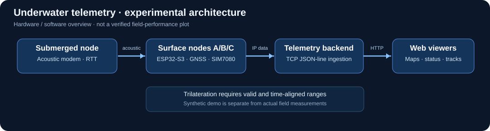

# Underwater Acoustic Telemetry

**Universitat Politècnica de Catalunya (UPC / SARTI) | Summer 2026**

**ESP32-S3 · Acoustic ranging · GNSS · LTE-M/NB-IoT · Embedded C++ · Python**

During my internship at SARTI, I worked on firmware and telemetry for an experimental system with surface and submerged acoustic nodes. The aim was to collect acoustic ranging information, combine it with GNSS positions from the surface nodes, and monitor the system through a local interface.



## System

The setup uses multiple surface nodes and an underwater node.

- **Surface nodes:** LilyGo ESP32-S3 / SIM7080G boards, GNSS, cellular modem, Wi-Fi and acoustic modem UART interface.
- **Underwater node:** coordinates acoustic ping exchanges and reports ranging information.
- **Backend:** receives JSON telemetry, stores node logs and performs geometric position calculations.
- **Web interface:** displays node state, location and ranging-related data.

The system estimates position from valid, time-aligned ranges to surface nodes. Acoustic propagation and modem response reliability affect the result; in the internship tests, acoustic reply behavior remained a point that needed further validation.

## Repository structure

| Directory | Contents |
| --- | --- |
| [SurfaceNode](SurfaceNode/) | ESP32-S3 firmware, GNSS and SIM7080G handling, UART modem commands, power control |
| [SubmergedNode](SubmergedNode/) | Acoustic ping and response handling |
| [server](server/) | Python telemetry server and 2D/3D positioning viewer |
| [ViewerServerV2](ViewerServerV2/) | Node.js monitoring and control dashboard |
| [tests](tests/) | Tests for positioning calculations and telemetry handling |
| [tools](tools/) | Offline test-log generator |

This was a team research project. The repository collects the software used in the system; it does not imply that every module was written individually by one contributor.

## Firmware setup

The firmware is organized as PlatformIO projects.

1. Open `SurfaceNode/` in PlatformIO.
2. Copy `SurfaceNode/src/config.example.h` to `SurfaceNode/src/config.h`.
3. Set your node address, network settings and server destination for your hardware.
4. Build, upload and inspect serial output or the local `/api/state` endpoint.

The submerged-node project is in `SubmergedNode/`. Its addressing must match the connected surface acoustic modems. Board pinout and network configuration depend on the particular hardware setup.

## Running the viewers

Start the Python receiver and viewer in separate terminals:

```bash
python3 server/telemetry_server.py --host 127.0.0.1 --port 2100
python3 server/viewer_server.py --host 127.0.0.1 --port 8080
```

Open `http://127.0.0.1:8080` for the Python viewer.

The alternative dashboard can be started with:

```bash
cd ViewerServerV2
npm install
npm start
```

Both interfaces can use port 8080, so run them separately or assign different ports.

## Offline positioning example

To test the viewer without hardware, there is a small **synthetic telemetry dataset generator**:

```bash
python3 tools/generate_synthetic_logs.py --out-dir server/logs
python3 server/viewer_server.py --host 127.0.0.1 --port 8080
```

It creates three simulated surface anchors with idealized range values. Those records are useful for checking the viewer and trilateration code; they are **not data from the deployed acoustic modems**. The generator will not overwrite existing node logs.

Run the backend tests with:

```bash
python3 -m unittest discover -s tests -v
```

The tests exercise coordinate conversion, trilateration and range filtering. They do not replace real modem tests or establish underwater localization accuracy.

## Ranging calculation

For an acoustic round-trip time `RTT_ms` and an assumed sound speed of `1500 m/s`:

```text
range_m = 1500 * RTT_ms / 2000
```

The calculation assumes the reported RTT corresponds to the acoustic travel time. Sound speed varies with water conditions, and modem response delay may require calibration.

## Notes

The firmware and viewers reflect a research prototype, including device and address variations across development versions. Real-world performance requires consistent device configuration, valid acoustic replies and verified timing.

Credentials and actual location logs are not included. The web-control interfaces are intended for a **trusted local network**, not an internet-facing service.

See [project scope](docs/scope-and-status.md) for implementation details and [sharing notes](docs/publication-checklist.md) for configuration and security considerations.
